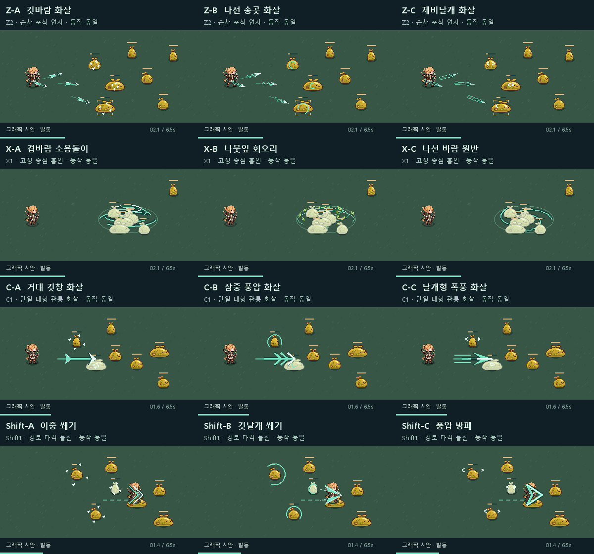

# 궁수 2차 그래픽 시안 12종

현재 선택: **Z-A 깃바람 화살 · X-B 나뭇잎 회오리 확정**. C와 Shift는 [재시안 각 5종](revision-2/README.md)에서 선택합니다. 아래 A/B/C 시안은 이전 비교 자료로 보존합니다.

2026-11-17. 확정된 **Z2·X1·C1·Shift1** 동작에 각각 그래픽 A/B/C를 적용한 비교 자료입니다.
실제 프로젝트의 궁수·노란 슬라임 스프라이트를 사용한 **별도 시뮬레이션**이며, Unity 실행 영상이나 최종 게임 적용본은 아닙니다.
기존 동작 시안과 게임 코드·씬·프리팹·에셋은 변경하지 않았습니다.

## 시안 보기

왼쪽부터 A, B, C입니다. 모든 GIF는 20fps·6.5초·무한 반복이며, 비교본은 1200×280, 개별본은 800×560입니다.

| 스킬 | A | B | C | 비교 |
| --- | --- | --- | --- | --- |
| Z2 순차 포착 | [깃바람 화살](Z-A.gif) | [나선 송곳 화살](Z-B.gif) | [제비날개 화살](Z-C.gif) | [Z 비교](Z-compare.gif) |
| X1 고정 회오리 | [겹바람 소용돌이](X-A.gif) | [나뭇잎 회오리](X-B.gif) | [나선 바람 원반](X-C.gif) | [X 비교](X-compare.gif) |
| C1 대형 관통 | [거대 깃창 화살](C-A.gif) | [삼중 풍압 화살](C-B.gif) | [날개형 폭풍 화살](C-C.gif) | [C 비교](C-compare.gif) |
| Shift1 경로 돌진 | [이중 쐐기](Shift-A.gif) | [깃날개 쐐기](Shift-B.gif) | [풍압 방패](Shift-C.gif) | [Shift 비교](Shift-compare.gif) |

## 그래픽 차이

- **Z-A:** 흰 화살촉·가는 대·갈라진 깃과 작은 타격 파편. **Z-B:** 긴 촉과 회전 나선·고리형 명중 효과. **Z-C:** 뒤로 젖혀진 촉과 두 줄 잔상·V자 파편.
- **X-A:** 끊어진 타원 띠가 층층이 회전. **X-B:** 얇은 바람과 안쪽으로 회전하는 잎 조각. **X-C:** 지면에 펼쳐진 세 갈래 나선. 생성·소멸 구간에는 크기를 줄이고, 중심을 채우지 않아 적이 보이도록 구성했습니다.
- **C-A:** 큰 창날·긴 대·꼬리깃. **C-B:** 하나의 몸체에 세 겹의 쐐기 윤곽. **C-C:** 긴 날개형 바람과 두 줄 잔상. 세 안은 모두 하나의 투사체이며 같은 시점에 같은 적을 타격합니다.
- **Shift-A:** 앞쪽 이중 V자 바람. **Shift-B:** 양옆 깃날개가 앞으로 모이는 형태. **Shift-C:** 속이 빈 화살촉형 방패. 추가 공격 없이 같은 돌진 경로·타격·밀치기를 사용합니다.

## 제작과 검증

- `generate.py`는 상위 `../generate.py`의 Z2/X1 시뮬레이션과 공통 렌더 도구를 불러옵니다. Pillow와 Windows 맑은 고딕 글꼴이 필요합니다.
- 실제 스프라이트 출처: `Assets/Textures/CharacterMotion/Frames/`, `Assets/Art/Enemies/RandomAppearance/Slime/yellow/`.
- 같은 스킬의 A/B/C는 한 번 계산한 위치·체력·표적·화살·타격 데이터를 공유합니다. 렌더링 전후 데이터 불변 검사를 수행하고 스킬별 SHA-256을 `verification.json`에 기록합니다.
- GIF 16개를 다시 열어 각각 130프레임·6,500ms·무한 반복 설정을 검사했습니다. 정지 비교표에서 한글 표시, 잘림, 화살 형태, 회오리 내부 가독성을 확인했습니다.
- 게임 내 실제 판정 폭과의 최종 일치, 장애물·배경·실루엣과의 합성, 성능은 Unity 적용 단계에서 별도 검증해야 합니다. 본 자료는 그래픽 선택을 위한 시안입니다.

초기 추천 기록: Z-A · X-A · C-A · Shift-A. 현재 확정 선택은 상단 기록을 따릅니다.
